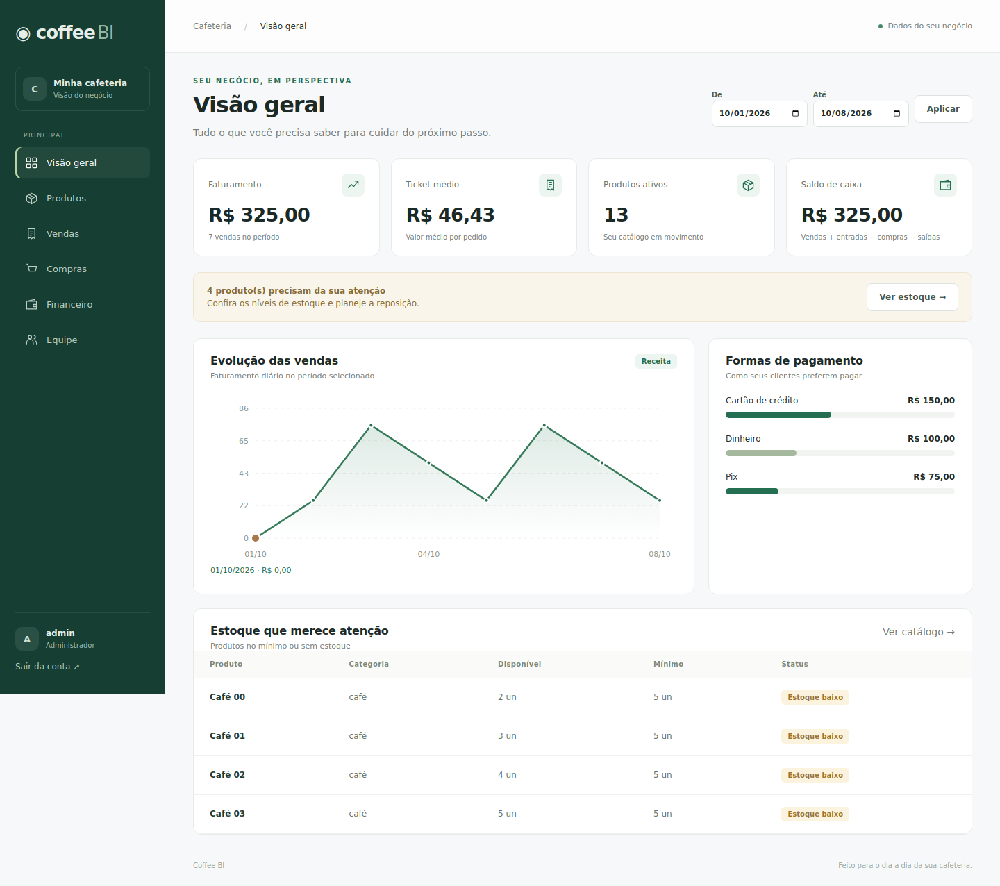

# Coffee BI

Gestão de cafeteria com catálogo, estoque, vendas, compras, equipe, financeiro e indicadores. A interface web em FastAPI é a entrada recomendada. O Streamlit original continua disponível e compartilha o banco e os serviços corrigidos.



## Iniciar na faculdade: banco local + API

Use Python 3.12 ou 3.13. No terminal, dentro da pasta do projeto:

```powershell
py -m venv .venv
.venv\Scripts\python.exe -m pip install -e .
.venv\Scripts\BI.exe init --dev
```

Se o ambiente já está ativado:

```powershell
python -m pip install -e .
BI init --dev
```

Linux/macOS:

```bash
python -m venv .venv
source .venv/bin/activate
python -m pip install -e .
BI init --dev
```

- Interface: **http://127.0.0.1:8000**.
- API interativa: **http://127.0.0.1:8000/docs**. Faça login na interface ou execute `/api/auth/login` no Swagger para testar as operações autenticadas.
- Login de desenvolvimento: **dev / dev12345** (administrador).
- Banco: **`%USERPROFILE%\.coffee-bi\dev.sqlite3`** no Windows; **`~/.coffee-bi/dev.sqlite3`** no Linux/macOS.
- SQLite é um arquivo local: não precisa instalar/configurar PostgreSQL, Firebase, Docker nem um servidor de banco.
- A primeira execução cria as tabelas, a conta dev, 13 produtos e 3 funcionários de exemplo. Não inventa histórico de vendas; registre uma venda para alimentar os indicadores.
- Reiniciar ou recarregar não apaga dados, não duplica exemplos e não restaura estoque alterado. O banco é o mesmo mesmo que o comando seja executado de outra pasta.
- `--dev` escolhe o banco local mesmo se `.env`/ambiente apontar para um banco remoto; o arquivo `.env` não é modificado.
- API e interface funcionam sem serviços externos após instalar as dependências, inclusive o Swagger. O login continua necessário.
- Alterações Python recarregam a API automaticamente; para alterações em HTML/CSS/JS, atualize a página. **Ctrl+C** encerra o servidor.

Porta alternativa e pasta portátil para guardar o banco junto do projeto:

```powershell
BI init --dev --port 8001 --data-dir .coffee-bi
```

Continue indicando a mesma pasta ao reiniciar. O acesso dev tem credencial de exemplo e o launcher aceita somente endereços locais nesse modo.

Se `BI` não for reconhecido, instale novamente no ambiente correto (`python -m pip install -e .`) e use **`python -m coffee_bi init --dev`** ou **`.venv\Scripts\BI.exe init --dev`**. Um `BI.exe` antigo de outro ambiente não inicia esta versão.

## Execução padrão / banco existente

`BI init` inicia a mesma API com as configurações normais do ambiente/.env, sem a conta ou o catálogo dev. Copie `.env.example` para `.env` e configure `ADMIN_PASSWORD` com uma senha própria de 6 caracteres ou mais (máximo 72 bytes UTF-8). O administrador só é criado se ainda não houver conta com `ADMIN_USERNAME`; senhas existentes são preservadas.

```bash
python -m pip install -e .
BI init
```

Também é possível executar diretamente `python -m uvicorn api.main:app --reload`.

- `DATABASE_URL` mantém o SQLite padrão ou aponta para PostgreSQL. Para PostgreSQL instale **`python -m pip install -e ".[postgres]"`**; o driver é opcional no modo local.
- URLs `postgres://` e `postgresql://` usam explicitamente `psycopg2`.
- Para reutilizar dados, indique o mesmo banco da aplicação anterior. Um caminho SQLite absoluto evita abrir outro banco ao executar de uma pasta diferente.
- `CAIXA_USERNAME` e `CAIXA_PASSWORD` criam opcionalmente um operador.
- `BUSINESS_TIMEZONE` controla as datas do negócio; padrão: `America/Sao_Paulo`.
- Use `COOKIE_SECURE=true` em HTTPS; o modo dev define cookie local para HTTP.

Dados de demonstração são opcionais no modo padrão: `python init_db.py` adiciona catálogo e funcionários idempotentemente; `python init_db.py --no-examples` cria somente tabelas/usuários configurados.

## Rotas e comportamento

| Recurso | GET | POST | PUT | DELETE |
|---|---|---|---|---|
| `/api/products` | Lista paginada; `/{id}` detalha | Cria produto | `/{id}` edita, com `If-Match` | `/{id}` desativa |
| `/api/employees` | Lista; `/{id}` detalha | Cria funcionário | `/{id}` edita | `/{id}` desativa e revoga o acesso vinculado |
| `/api/transactions` | Lista; `/{id}` detalha | Cria lançamento | `/{id}` edita | `/{id}` exclui |
| `/api/sales` | Lista; `/{id}` detalha | Registra venda e baixa estoque | — | `/{id}` cancela e devolve estoque |
| `/api/purchases` | Lista; `/{id}` detalha | Registra compra e atualiza estoque/custo | — | `/{id}` cancela se houver estoque suficiente |
| `/api/auth/login` | — | Autentica e define cookie HttpOnly | — | — |
| `/api/auth/me` | Usuário atual | — | — | — |
| `/api/auth/logout` | — | Revoga sessão | — | — |
| `/api/dashboard` | Indicadores, série diária e formas de pagamento | — | — | — |
| `/api/health` | Verifica aplicação e conexão com banco | — | — | — |

Listas aceitam `page`, `page_size` (1–100), `sort`, `direction` e `q`. Produtos também aceitam `active=true/false`. A busca de vendas e compras usa o ID. O dashboard aceita `start` e `end` em formato ISO, em um período de até 366 dias.

**Edição concorrente de produtos:** a resposta traz `version`. Ao editar, envie esse valor no cabeçalho `If-Match`. Se outra venda, compra ou edição tiver alterado o produto, a API responde `409`; reabra a edição com os dados atuais. O frontend já faz isso automaticamente.

**Vendas/compras são movimentos fechados:** correções são feitas por cancelamento e novo registro. O total é calculado no servidor a partir de quantidade × preço, com `Decimal`; subtotais enviados por clientes não são aceitos pela API. Uma falha em qualquer item desfaz a operação inteira.

**Permissões:** o caixa consulta produtos e indicadores e registra/consulta vendas. Cadastro e edição de produtos, equipe, compras, financeiro e cancelamentos exigem administrador. As permissões são verificadas no backend.

## Banco existente e custos

Na inicialização, as tabelas novas são criadas e duas colunas são adicionadas se necessário: `produtos.version` e `itens_venda.custo_unitario`. Nenhuma tabela de negócio é apagada. Faça uma cópia do banco antes de atualizar uma instalação com dados reais. Inicie uma instância para aplicar a migração antes de subir múltiplos workers.

Novas vendas guardam o custo no momento do pedido. Vendas anteriores não têm esse histórico; o relatório usa o custo atual como estimativa para esses itens. O saldo de caixa considera vendas + entradas avulsas − compras − saídas avulsas; não representa lucro contábil. Não registre novamente vendas/compras como lançamentos avulsos, para evitar contagem duplicada.

O cancelamento de uma compra reverte a quantidade; mantém o custo médio vigente. A reavaliação contábil de estoque após devoluções não faz parte desse fluxo.

## Interface Streamlit

```bash
python -m pip install -r requirements.txt
python -m streamlit run app.py
```

Os serviços de venda, compra e estoque corrigidos também são usados nessa interface. O gerenciamento avançado de usuários e redefinição de senha permanece na tela **Funcionários**, com acesso de administrador.

## Validar

```bash
python -m pip install -r requirements-dev.txt
python -m pip install -e .
python -m pytest -q
python -m playwright install chromium
python tests/browser_smoke.py
python tests/dev_smoke.py
```

Os testes usam bancos temporários; o teste de navegador inicia seu próprio servidor. Para testar PostgreSQL, configure `COFFEE_TEST_DATABASE_URL` **exclusivamente com um banco descartável**, pois as tabelas desse banco são recriadas. Nunca use o banco real nessa variável. A CI testa SQLite/PostgreSQL e Python 3.12/3.13.

O teste de navegador percorre o CRUD com requisições reais, recarrega a página para verificar persistência, verifica feedback de estoque insuficiente, paginação, ordenação, gráficos, layout móvel e logout. Capturas ficam em `docs/screenshots/`.

Detalhes da auditoria e limites da validação: [docs/AUDITORIA.md](docs/AUDITORIA.md).

Para verificar também a interface anterior, com `requirements.txt` instalado:

```bash
python tests/streamlit_smoke.py
```
